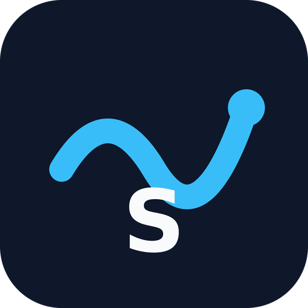
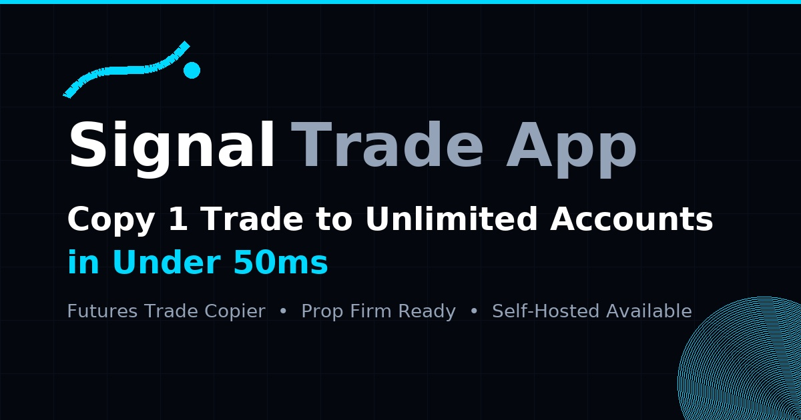

# Signal Trade App: cloud futures trade copier for prop firms

**[Signal Trade App](https://signaltradeapp.com/)** is a cloud trade copier for futures prop firm traders. Trade one leader account and every follower copies it, across **Tradovate** and **Rithmic**, at its own size. It runs 24/7 in the cloud, so your PC doesn't need to stay on.

**$29/month, unlimited accounts.** [Start a 5-day free trial](https://signaltradeapp.com/register) · [Pricing](https://signaltradeapp.com/pricing) · [User guide](https://signaltradeapp.com/user-guide)

> This repository hosts documentation and the public issue tracker. The platform itself is closed source.

## Features

| | |
|---|---|
| **Trade copier** | One leader, unlimited followers. Market, limit, bracket and stop orders. Each follower uses its own copy ratio (1x to 100x). |
| **Cross-broker** | Rithmic → Tradovate, Tradovate → Rithmic, or any mix of the two in one group. NinjaTrader on Tradovate-cleared accounts is copied as Tradovate. |
| **Speed** | Orders reach Tradovate in under 50 ms and Rithmic in under 5 ms. |
| **Per-instrument rules** | Set a different ratio per instrument (NQ x3, ES x5), or copy mini to micro (NQ → MNQ, ES → MES, YM → MYM, RTY → M2K). |
| **Daily P&L Lock** | Set a daily loss limit and profit target per account. When either is hit, positions are flattened and the account is locked until 6 PM ET. |
| **Risk tracking** | Track each account's static, trailing or EOD max drawdown and profit target, with alerts. |
| **Account lockouts** | Lock accounts during chosen sessions or on demand. A locked account is flattened and receives no copies. |
| **Protect** | When the leader goes flat on a symbol, every follower's position in that symbol is closed. |
| **Trading journal** | Trades import automatically, with P&L, win rate, profit factor, Sharpe ratio, a P&L calendar, notes, tags and CSV export. |
| **TradingView webhooks** | Pine Script alerts execute on every connected account. |
| **Share P&L** | Turn closed trades into a shareable P&L card. |
| **MCP server** | Claude and other AI assistants can read your accounts, positions, trades and P&L. It's read-only and can't place orders. [Setup](https://signaltradeapp.com/mcp) |
| **API** | Full REST API on Pro. [API docs](https://signaltradeapp.com/api-docs) |

## Documentation

**User guide** ([docs/guide](docs/guide/README.md)): [getting started](docs/guide/getting-started.md) · [brokers and prop firms](docs/guide/brokers-and-prop-firms.md) · [how copy trading works](docs/guide/copy-trading.md) · [risk management](docs/guide/risk-management.md) · [managed protection](docs/guide/managed-protection.md) · [chart trading](docs/guide/chart-and-trading.md) · [journal](docs/guide/journal-and-analytics.md) · [billing](docs/guide/billing.md) · [troubleshooting](docs/guide/troubleshooting.md)

**Developers** ([docs/developers](docs/developers/README.md)): [TradingView webhooks](docs/developers/tradingview-webhooks.md) · [REST API](docs/developers/rest-api.md) · [live stream](docs/developers/streaming.md) · [MCP server](docs/developers/mcp.md) · [recipes](docs/developers/recipes.md) · [OpenAPI spec](openapi.json) · [examples](examples/) (curl, Python, Pine Script)

## Supported brokers and prop firms

- **Tradovate:** Take Profit Trader, MyFundedFutures, Tradeify, LucidTrading and other Tradovate firms
- **Rithmic:** Apex Trader Funding, Earn2Trade and other Rithmic firms
- **Propr (Hyperliquid perps):** copy between Propr accounts
- **Not supported:** Topstep / TopstepX, Bulenox (its rules don't allow outside copy tools), and real-money (live) brokerage accounts.

[Full list of brokers and prop firms](https://signaltradeapp.com/help/which-brokers-and-prop-firms-are-supported)

## Plans

- **Pro:** $29/month for unlimited accounts and copy groups, the API, the journal and charts, with a 5-day free trial.
- **Self-hosted:** $599 one-time. A ready-to-run Docker Compose deployment on your own server, with lifetime updates. [Details](https://signaltradeapp.com/self-hosted)
- **For prop firms:** white-label the platform under your own brand. [Prop firm platform](https://signaltradeapp.com/prop-firm-platform)
- **Affiliates:** earn 30% recurring commission. [Affiliate program](https://signaltradeapp.com/affiliate)

## Learn more

- [Quick start](https://signaltradeapp.com/user-guide/quick-start)
- [Tradovate trade copier](https://signaltradeapp.com/tradovate-trade-copier)
- [Daily loss limit lock](https://signaltradeapp.com/daily-loss-limit-lock)
- [Per-instrument rules and cross order](https://signaltradeapp.com/user-guide/per-instrument-rules-cross-order)
- [Trading journal](https://signaltradeapp.com/trading-journal)
- [Help center](https://signaltradeapp.com/help)
- [Blog](https://signaltradeapp.com/blog)

## Support

To report a bug or request a feature, open an [issue](../../issues).
Follow us on [X](https://x.com/signaltradeapp), [Instagram](https://www.instagram.com/signal.trade.app/), [TikTok](https://www.tiktok.com/@signal.trade.app) and [LinkedIn](https://www.linkedin.com/company/signaltradeapp).

---

Futures trading carries substantial risk of loss. Copied trades can fill at different prices than the leader's. Signal Trade App is not affiliated with Tradovate, Rithmic or any prop firm.
